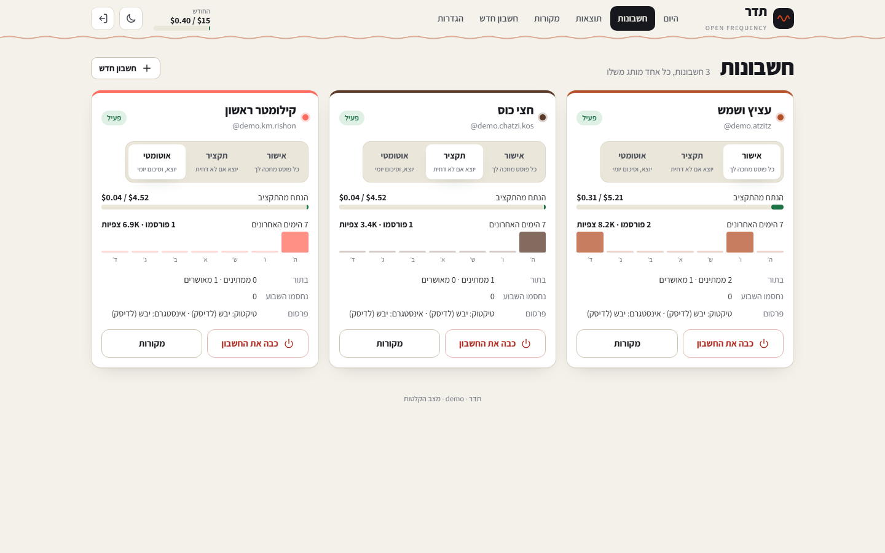

# open-frequency

One engine that runs several Hebrew social accounts, each in its own niche and
each its own brand, mostly on its own. It reads approved sources, drafts
slideshows grounded in quotes it can prove (stories, head-to-heads, guess-who,
rankings, icebergs, hot takes: ten kinds of post, entertaining first), checks
them in code, renders them,
and publishes them after the approval each account's mode asks for: to TikTok
through Zernio, to Instagram directly through Meta's own Graph API. It runs on a
hard budget of $15 a month for every metered service but Zernio. Its website, **Teder** (תדר), is where the owner approves, edits and steers.

<p align="center">
  
  
</p>

This repository is public. It holds the engine, the website, the tests, the docs
and one fictional demo pack. Real accounts, their database, rendered media,
recordings and keys live in a private folder, `$OF_HOME`, which is never
committed (see [The private folder](#the-private-folder)).

## Try it in two minutes

```bash
npm install
npx playwright install chromium
npm run demo        # a fictional demo with three brands, then the website on :4700
```

`npm run demo` builds a throwaway home in `./.demo`, makes posts in every state
from the fictional pack's recordings (no network, no keys), and prints a login.
Nothing in it is real, and the Results page says so.

## Running it

| Command | What it does |
|---|---|
| `npm test` | every hard rule, offline, then `check:public` |
| `npm run dry -- --pack <id> --count 5 [--format <id>] [--day YYYY-MM-DD]` | builds 5 posts for one pack and writes each to disk: slides for each platform, `caption.txt` (TikTok) and `caption-instagram.txt`, `sources.md` (every fact, its quote, its source), `post.json` (checks, trace, cost). Its own database; publishes nothing |
| `npm run web` | the website on `127.0.0.1:4700` |
| `npm start` | the website and the runner: daily generation, publishing at each slot, metrics, learning |
| `npm run record -- --pack <id> [--source <id> --url <page> --key <name>]` | saves a pack's approved sources as recordings, so it runs offline. `--title "Article#intro;Section"` records Wikipedia articles (several titles are one group, read together), `--group <key>` groups documents from different sources, `--filter '<json>'` narrows a data.gov.il source |
| `npm run launch -- run|review|verdicts|status|costs --pack <id>` | the launch set: the first posts of a new account, made by the engine's own pipeline end to end (in development on the Claude Code CLI, never the project's key), each reviewed blind by three readers; see [The launch set](#the-launch-set) |
| `npm run visuals -- [--pack <id>]` | every graphic the engine draws, in a pack's theme, for TikTok and Instagram: for the eye after a change to the graphics |
| `npm run screenshots` | every page at phone and desktop width (`-- --dark` for both themes), from the demo only |
| `npm run init-private [-- --pack <id>] [-- --git]` | creates the private folder, optionally a blank pack and its own git repo |
| `npm run user:add -- <name>` | adds a website user (asks for the password) |
| `npm run backup` | a consistent copy of the database into `$OF_HOME/data/backups` |
| `npm run check:public` | fails if anything committed looks private (also a pre-commit hook) |
| `npm run budget [-- init]` | this month's Anthropic API spend, the cap, the warning level and the jobs that cost most; `init` creates the spend file once |
| `npm run zernio:check [-- --pack <id> --send-private --confirm]` | checks the Zernio key and every pack's TikTok account id, and what Zernio will bill; with the flags, sends one private (SELF_ONLY) test post and reports whether the AI flag and the analytics work |
| `npm run instagram:token -- --pack <id> --short <token>` | turns a short-lived Meta token into the pack's lasting one (see [Instagram](#instagram)) |
| `npm run instagram:check [-- --pack <id> --publish --confirm]` | checks each Instagram pack's token, account, token expiry, quota and insights; publishes only with the flags |
| `npm run live-day -- --allow-api --confirm` | the one measurement that needs the Anthropic key: one day of posts for every account on real calls through the API, in Approve mode, and what each really cost (`--allow-api` because a laptop is in development, where the API is refused) |
| `npm run compare -- next|status|score` | the cost and quality comparison behind [docs/costs.md](docs/costs.md), answered by Claude Code, never the project's key |

Requires Node 22.13 or newer (for `node:sqlite`); developed on 24.

### Modes

- **Recorded** (`OF_MODE=recorded`): sources and drafts come from each pack's
  `recordings/`. Every check, the fact gate, the renderer and the website run
  exactly as they would live; a post's cost is an estimate and says so.
- **Live** (`OF_MODE=live`, the default when there is a model to call): real
  sources, a real model.

Which model answers is the environment's (`OF_ENV`):

- **`dev`** (the default, a laptop): the Claude Code CLI, headless (`claude -p`), on
  your subscription. Each call is the request production would send (the same system
  blocks, user turn, image, schema, model and effort), one model request with every
  tool off, a fresh session that is never saved, without your machine's CLAUDE.md,
  hooks or MCP servers, and never with `ANTHROPIC_API_KEY` in its environment. Calls
  run one at a time, across processes too; on a usage limit the engine waits for the
  reset and makes the same call again. Each call's tokens are recorded with what it
  would cost through the API. Any call to the API itself is refused unless the
  command says `--allow-api`, and each refusal is logged in
  `$OF_HOME/logs/api-refusals.log`.
- **`prod`** (the server; the service unit sets it): the Anthropic API, the day's drafts
  through the Message Batches API with the pack's prefix cached.

Publishing is a separate, deliberate switch, per platform. Each pack names its
publisher for each platform in `pack.json`:

```json
"publishers": { "tiktok": "zernio", "instagram": "instagram" }
```

A platform's post leaves only when `PUBLISH_MODE=live` and that publisher has
what it needs (`ZERNIO_API_KEY` and the pack's Zernio account id; or the pack's
Instagram token and account id). Anything less writes the post and the exact
request to disk with the dry publisher. Changing a platform's publisher is a
line in `pack.json`, no code.

## The private folder

`$OF_HOME` holds everything that belongs to the real accounts. It defaults to
`./private/` inside the checkout and is gitignored entirely; set `OF_HOME` to put it
anywhere else.

```
private/
  packs/<id>/          one folder per account, with recordings/
  data/                openfrequency.db, media/, public/, out/, backups/
  .env                 keys (from .env.example)
  public-denylist.txt  words check:public refuses in the public repo
```

Set it up with `npm run init-private -- --git`. **Make `private/` its own private
git repository** (on GitHub, a private repo): that is how it is backed up and how
the VPS gets the packs (`git pull` inside `private/`). Its own `.gitignore` keeps
`data/` and `.env` out of it; back the database up with `npm run backup`.

**`git clean -fdx` in the engine checkout deletes `./private/`.** Push it first, or
keep `OF_HOME` outside the checkout.

`npm run check:public` runs in `npm test` and as a pre-commit hook (installed by
`npm install`). It reads the git index and fails on any file under `private/`, a
key-shaped string, a database, a pack outside `examples/`, media outside
`docs/screenshots/`, or any real pack id, handle, display name or Zernio id it finds
in `$OF_HOME/packs`, plus every word in `$OF_HOME/public-denylist.txt`.

## Adding an account

No code, ever. Two ways:

1. **On the website**, *New account*: enter a niche, an audience and a few example
   sites. The engine searches for authority sites (Brave), finds their feeds,
   suggests structured APIs, looks for formats that work on YouTube Shorts, and
   scores every source with a one-line reason. Approve the sources, name the
   account; the pack is written with a look no other account has. Five sample posts
   must pass and be reviewed before it goes live, in Approve mode.
2. **By hand**: `npm run init-private -- --pack <id>`, then edit the six files.

A pack is a folder:

| File | Holds |
|---|---|
| `pack.json` | id, display name, handle, the profile's bio, platforms, the publisher per platform, Zernio profile and account ids, the Instagram account (`instagram.userId`, `auth`, `tokenEnv`), schedule (windows, slots, posts per day), autonomy mode, its weight in the budget (`budget.share`), compliance checks, topics; `imagery` (`providers`: commons, pexels, unsplash, pack; `safety`: standard or strict); `events` and `schedule.fightWeek` for an account that follows fight cards; `endSlide` (`{ title, body }`, `{handle}` for the handle): a closing slide asking to follow, drawn after every post in place of a call to action on the last slide; `writing` (`slideBody`, `slideTitle`, `slideLines`, `cover`: `maxChars`, `sentences`, `maxWords`): shorter limits than the engine's, never longer |
| `voice.md` | who is talking, to whom, how it sounds; `## שורות טובות` and `## שורות רעות` with examples |
| `theme.json` | a template and variant from the engine's library, colours, fonts; `options`: `handleTag` (false: no handle on the slides), `sourceLine` (false: no source line on the slides; every fact keeps its source in the post's record, and a photograph's credit stays in the caption), `backgroundPhoto` (true: every slide on a photograph, blurred and veiled in the theme's ground colour, `backgroundVeil` 0.5 to 0.95), `coverPhoto`; `backgroundQueries`: the scenes searched when a post has no photograph of its own |
| `sources.json` | approved sources only: type (`rss`, `web`, `api`), url, name, why it is trusted, when approved |
| `formats.json` | the account's formats, each of one [kind](#post-formats) with its own name, weight, cover patterns (`hooks`: `{ id, pattern, examples }`) and calls to action (`ctas`: `{ kind: save|comment|send, text }`); the `mix` of entertaining formats (0.4 to 0.8, 0.6 by default); caption questions, hashtags, trend queries |
| `rules.json` | banned phrases, regex checks, blocked image words, the maximum quote length |
| `photos/` (optional) | photos the owner decided the account may use (an event photo), in `photos.json` with what is in each, where it came from and whom to credit; every one still passes the image screen |
| `facts/` (optional) | hand-checked facts, one file per topic: each sentence exactly as on its page, the page, the day it was checked and the day it expires. For official sites the engine may not read; added and rechecked on the website (*Sources* > *עובדות שנבדקו ביד*) |

Validation refuses a pack with weak contrast, a source without https or a reason to trust it, a money
niche without the investment-advice check, and any two packs sharing a template, a
display face, a handle, a name, a Zernio profile, or a palette too close to tell apart.

## How a post is made

```
format (by the mix and results) -> documents from the format's approved sources
      -> outline (and the articles to read next) -> research: those articles read,
      the details a fan would want pulled out and verified (three, or the next topic)
      -> facts verified -> the kind's shape checked -> slides with their graphics (a
      cover pattern and a call to action chosen in code) -> voice, tell, shape, visual
      and fact checks -> review -> photographs, screened and checked against their
      slides -> render -> queue -> approval (by mode) -> publish -> metrics at 72h
      -> learn
```

Every step is a row in the database, so any slide traces back to its fact, the
quote, the stored document and the approved source. The website's post page shows
the whole trace.

## Post formats

A pack's format is one of ten kinds (`src/formats/kinds.js`). The engine owns the
shape, checks it in code and draws it; the pack brings the name, the cover
patterns and the calls to action.

| Kind | Group | Shape (after the cover) |
|---|---|---|
| `story` | entertaining | 3 to 5 build-up slides, the twist or payoff last |
| `what-happened` | entertaining | then, the turn, now (documented facts about people only) |
| `on-this-day` | entertaining | context, the moment, what came after; drafted only from documents that name the day |
| `guess-who` | entertaining | 3 clues, the answer last; the answer may not appear before it (cover, clues, captions, keywords are checked) |
| `iceberg` | entertaining | 4 to 6 layers, famous to obscure; the design draws the depth |
| `hot-take` | entertaining | the opinion (labelled as one), 3 to 5 slides of sourced case, "agree?" |
| `myth-fact` | entertaining | 2 or 3 pairs: a myth as people say it, the fact that answers it |
| `meme` | entertaining | 3 to 5 jokes on the account's own design, the real fact behind them last |
| `head-to-head` | number | two sides, 3 to 6 stats with both values, the verdict last |
| `ranking` | number | a top 5 (or a top 10, places 10 to 6 on one slide), number one last; the design draws the places |
| `list` | number | the phase 1 shape: items and a closing slide |

Every post has pictures as much as words: at least half of its slides carry a
visual, and the cover always does. The engine draws its graphics from data the
drafting model writes on a slide (a timeline, stat bars, a head-to-head card, one big
number, a calendar page, a pitch with the players, kit colours, a fight record, the
weight-class ladder, a product's stack, a funnel, price cards, a mock screen); each
theme names the ones that fit it (`theme.json` `visuals`), and every number a graphic
draws is held to the slide's quotes by the fact gate. A slide about a person or a place
can ask for a licensed photograph of them: it is used only if its own title,
description or categories name the subject, it passes the image screen, and a vision
check says it fits the slide; otherwise the slide keeps its graphic. The cover shows a
photograph, the graphic the model chose for it, or the art of its kind. An account's
mark (`brand/logo.png` in the pack) is drawn small on the first and last slides.

Every post: 5 to 8 slides, one idea a slide, the payoff on the last slide with the
call to action drawn on it, keywords in Hebrew and English on the last slide above
the call to action (TikTok's search reads them), a long TikTok caption (200 characters and up) and a short
Instagram one led by the cover line. A slide with no fact of its own (a myth, a
verdict, a joke's setup) still holds no number the post's quotes do not.

## The hard rules, and where they are enforced

| Rule | Where |
|---|---|
| 1. Official APIs only; no likes, follows, comments, DMs or logged-in reading | `src/core/net.js` is the only `fetch`; its write allowlist is Claude (messages, batches), Zernio's create-post, Meta's two publishing endpoints for an Instagram account, and deleting our own Instagram post after a takedown notice; it refuses Zernio's inbox and every Graph edge for comments, mentions, tags, messages, hashtags and other accounts by name. Tests scan the code for any other `fetch`, engagement functions and endpoints |
| 2. Each account a distinct brand | `src/packs/validate.js` (`validateAll`), and a cross-promotion check on every post |
| 3. Honest by construction | `src/verify/claims.js`: every quote verbatim in a stored document of an approved source of that account; every number on a slide in its quotes; the renderer refuses text without the gate's token; `src/voice/honesty.js` refuses invented experience and fake badges or metrics |
| 4. AI disclosure | `src/publish/zernio.js` sets TikTok's `video_made_with_ai` (as a draft for photo posts); `src/publish/instagram.js` adds a caption line on Instagram |
| 5. Rights | `src/images/index.js`: Pexels, Unsplash, Commons (and photos the owner adds to a pack, with their origin), licence stored, Commons licences on an allowlist, logos and crests refused; `src/images/safety.js` screens every photo for blood, injuries, a fighter down, watermarks and belts; `src/publish/takedown.js` takes a post down on a notice; quotes are short facts (4 to 40 words) |
| 6. No investment advice | `src/rules/compliance.js`, required for any money niche |
| 7. Cost caps | `src/budget/ledger.js`: every paid call reserves its worst case against `OF_BUDGET_MONTHLY_USD` and the account's share before it is made, and records its real cost from the API's usage after; `src/budget/plan.js` cuts volume, never quality, when the month runs short |
| 8. Hebrew RTL | slides and every page are `lang="he" dir="rtl"` (tested) |
| 9. Shabbat and the festivals | `src/schedule/shabbat.js` and `src/schedule/hebrew.js`: Shabbat and every yom tov (Rosh Hashana, Yom Kippur, the first and last days of Sukkot and Pesach, Shavuot) from candle lighting the evening before to nightfall, from the real sunset and the Hebrew calendar; the scheduler never plans such a slot and every publisher refuses one |
| 10. Secrets | `.gitignore`, `check:public`, the pre-commit hook; `.env.example` lists every variable (tested) |

## Autonomy

| Mode | |
|---|---|
| **Approve** | every post waits for the owner; unapproved by the end of its day, it expires. The default for a new account |
| **Digest** | posts go out at their slot unless rejected before it |
| **Auto** | posts go out; a daily summary is written to the website |

In every mode: a kill switch per account and a global one, and an automatic pause
on a failed fact check, a platform strike, a streak of publish errors, or an
exhausted budget. A paused account says why. In Digest and Auto, a post the
reviewer scored as sounding a little like a bot waits for the owner instead.

The runner also reads each post's numbers at 72 hours (TikTok through Zernio:
shares and likes per view; Instagram from Meta's own insights: saves per reach,
or per view where Meta gives no reach; never a number the API did not give). It
picks the group first by the account's mix of entertaining and number posts (60%
entertaining to start, moved 5 points a week at most, within 40% to 80%, towards
the group that does better), keeps 70% of posts on proven formats and 30% on
trials, drops a format after three results in a row under 70% of the median,
gives each cover pattern its turns and then favours the ones that work, and once
a week looks for formats that work on YouTube Shorts, copying the format and
never the content. The Results page says all of it in plain words.

### Fight week

An account that follows fight cards (`events` and `schedule.fightWeek` in
`pack.json`) reads the calendar once a day from a public listing (Wikipedia's
list of events, through its API). Three days before a card, the day's first slot
is a tale of the tape; the day before, the account's pick; the morning after, a
recap, drafted only once the card is over (`recapAfter`) and from documents that
name both fighters, again every 45 minutes until the results are in the sources.

### Takedowns and the image screen

A takedown notice is recorded on the post's page. The post comes down at once:
on Instagram it is deleted through the Graph API (Facebook Login, the
`instagram_manage_contents` permission); on TikTok, which has no delete for a
third party (not through Zernio, not through TikTok's own APIs), it is listed for
the owner to delete in the app, with a button to say it is done. A second notice
for the same account within 90 days pauses it.

Every photo is screened before it is used: words in its description (blood,
knockout, a watermark, a belt) refuse it; a picture with a lot of deep red goes to
a person; with a live key, Claude Haiku looks at it. What none of them clears is
held: the post can be approved but is not published until someone has looked at
the photo on its page. `imagery.safety: "strict"` sends every photo of the pack
to the model or to a person.

## The budget

`ANTHROPIC_MONTHLY_BUDGET_USD` in `$OF_HOME/.env` ($20 by default; the owner raised
it from $15 on 2026-10-15) is a hard cap on the Anthropic API and the small metered
services that share it (Brave, the image APIs). `ANTHROPIC_BUDGET_WARN_USD` ($15) is
the warning level. Zernio is billed per connected account and is outside it (see
[docs/costs.md](docs/costs.md)).

- **One door, and a second record.** Every API call goes through `askJson`
  (`src/llm/index.js`), and only `src/llm/claude.js` imports the SDK (a test holds
  that). Before each call, `src/budget/anthropic.js` checks the model is in the
  pricing table (`src/budget/pricing.js`, with the day it was verified; an unknown
  model is refused, never guessed) and that this month's spend, plus what calls in
  flight hold, plus this call's worst case, fits under the cap. After each call it
  adds the real cost from the usage block (cache writes and reads, and the batch
  discount) to `$OF_HOME/data/anthropic-spend.json`, written whole and renamed into
  place, and writes one line to `$OF_HOME/logs/anthropic-calls.jsonl` (time, model,
  tokens, cost, job: never the prompt or the key). A refusal is a `BudgetExceededError`:
  the job is skipped and logged, the engine goes on.
- **It fails closed.** When the spend file is missing or unreadable every API call is
  blocked and the reason logged, never a silent $0. `npm run budget -- init` creates
  it once (a new server runs it before its first live day), starting the month at
  what the ledger recorded; it never overwrites a file that exists.
- **`npm run budget`** prints the month's spend (UTC), the cap, the warning level and
  the jobs that cost most.

- **Nothing can spend past it.** Every paid call first reserves the most it could
  possibly cost (its prompt's bytes and its `max_tokens`, at the dearest rate it can
  be billed at), against the cap and the account's share. When the answer comes
  back, the reservation is replaced by the real cost from the usage the API
  returned. Tested with worst-case bills, one at a time, at once and in batches.
- **Each account has a share**, by its `budget.share` weight, after a small reserve
  for onboarding.
- **Volume, never quality.** Each day before drafting, the month is forecast at the
  planned volume and the measured cost per post. If it does not fit, the weakest
  account (by its results, else by how often you approved it) comes down half a
  post a day at a time to one a day, then the next; past that, to a post every
  other day. The money freed goes to the others. Every page says so. At the
  measured cost, about 86 posts a month fit in $15 ([docs/costs.md](docs/costs.md)).
- **80%** spent: a warning on every page. **100%**: nothing is drafted until the
  next month. Settings shows the spend, the forecast and the posts left.
- **Cheap by design**: drafting on Claude Sonnet 5.5 through the Message Batches
  API (half price) a day ahead, the pack's voice and rules as a cached prefix,
  documents narrowed to their content, punctuation tells fixed in code, one
  redraft at most, the review on Sonnet and a rewrite only for what it flags.
  [docs/costs.md](docs/costs.md) has the measurements.

## Instagram

Instagram posts go out directly through Meta's official Graph API, free, as a
carousel. Set it up once per account:

1. **The account.** In the Instagram app, switch the account to a professional
   account (business or creator), and link it to a Facebook Page you manage
   (Settings > Account type and tools, or the Page's *Linked accounts*).
2. **A Meta app.** At developers.facebook.com, create an app of type *Business*
   and add the Instagram API with Facebook Login. As long as only people with a
   role on the app (you) use it, Standard Access is enough: no App Review, no
   business verification. Copy the app's id and secret (App settings > Basic) into
   `$OF_HOME/.env` as `META_APP_ID` and `META_APP_SECRET`.
3. **A short-lived token.** In the Graph API Explorer, pick the app, *Get User
   Access Token*, and grant `instagram_basic`, `instagram_content_publish`,
   `instagram_manage_insights`, `pages_show_list` and `pages_read_engagement`
   (and `business_management` if the Page sits in a business portfolio). Grant
   `instagram_manage_contents` too: it is what lets the engine delete a post after
   a takedown notice (Meta added it in December 2025; a token made without it can
   publish but not delete, and the post is then listed for you to delete by hand).
4. **The lasting token.** `npm run instagram:token -- --pack <id> --short <token>`.
   The first time it lists your Pages and their Instagram accounts: put the
   account's id in `pack.json` as `instagram.userId` and run it again. It
   exchanges the token for a 60-day user token and from it takes the Page's token,
   which does not expire, stores it for the pack, and prints the line for
   `$OF_HOME/.env` (`IG_TOKEN_<PACK>`, or the name in `instagram.tokenEnv`).
5. **The pack.** In `pack.json`: `"publishers": { "instagram": "instagram" }` and
   `"instagram": { "userId": "...", "auth": "facebook" }`.
6. **Check it.** `npm run instagram:check` says whether the token reaches the
   account, when the token and Meta's data access expire, how much of the
   publishing quota is left, and whether insights can be read. It publishes only
   with `--publish --confirm`, and that post is public.

**Refresh.** A Page token does not expire, but Meta ends a token's data access
after 90 days without use; publishing and reading insights use it daily, and
`instagram:check` shows the date. If it ever lapses, repeat steps 3 and 4. An
account on *Instagram Login* instead (`"auth": "instagram"`, no Facebook Page) has a
60-day token: the runner refreshes it once a day when 20 days or fewer are left,
and keeps the new one in the database.

**Instagram Login, from the app's dashboard.** With the *Instagram API with
Instagram Login* product there is no Page and no redirect address: on the
product's setup page, under *Generate access tokens*, add the Instagram account,
log in to it, and click *Generate*. That token already lasts 60 days: put it in
`$OF_HOME/.env` as `IG_TOKEN_<PACK>`, the account's id in `pack.json` as
`instagram.userId` with `"auth": "instagram"`, and run `npm run instagram:check --
--pack <id>`. The API cannot delete a post on this login, so after a takedown
notice the post is listed for you to delete by hand.

Instagram fetches each slide from `MEDIA_PUBLIC_BASE_URL` (JPEG, 1080x1350), so
that address must be live before the first post.

## Deploying

On the VPS (Ubuntu 24.04 here), behind Caddy, like any small Node service. These
steps are tested end to end in a clean container by `deploy/test/run.sh`.

1. **Node 24 and Caddy**, from their own repositories:
   ```bash
   curl -fsSL https://deb.nodesource.com/setup_24.x | sudo bash - && sudo apt-get install -y nodejs
   sudo apt-get install -y debian-keyring debian-archive-keyring apt-transport-https
   curl -1sLf 'https://dl.cloudsmith.io/public/caddy/stable/gpg.key' | sudo gpg --dearmor -o /usr/share/keyrings/caddy-stable-archive-keyring.gpg
   curl -1sLf 'https://dl.cloudsmith.io/public/caddy/stable/debian.deb.txt' | sudo tee /etc/apt/sources.list.d/caddy-stable.list
   sudo apt-get update && sudo apt-get install -y caddy
   ```
2. **The service user, the two repositories, Chromium:**
   ```bash
   sudo useradd --system --create-home --home-dir /var/lib/openfrequency --shell /usr/sbin/nologin openfrequency
   sudo git clone <this repo> /opt/open-frequency
   sudo git clone <your private repo> /opt/open-frequency/private
   cd /opt/open-frequency && sudo npm ci --omit=dev
   sudo PLAYWRIGHT_BROWSERS_PATH=/opt/open-frequency/.browsers npx playwright install --with-deps chromium
   sudo mkdir -p private/data && sudo chown -R openfrequency:openfrequency private
   ```
3. **`private/.env`**, owned by `openfrequency`, mode 600: at least
   `SESSION_SECRET` (`openssl rand -hex 32`), `OF_ADMIN_USER`, `OF_ADMIN_PASSWORD`
   (remove it after the first start), `PUBLIC_HOST`, `MEDIA_PUBLIC_BASE_URL`,
   `ANTHROPIC_MONTHLY_BUDGET_USD`, `ANTHROPIC_BUDGET_WARN_USD`, and the keys you have.
   Then, once, as `openfrequency`: `npm run budget -- init` (without the spend file
   every API call is blocked).
4. **The service:** `sudo cp deploy/openfrequency.service /etc/systemd/system/`,
   `sudo systemctl daemon-reload`, `sudo systemctl enable --now openfrequency`.
   `curl -H 'Host: 127.0.0.1:4700' http://127.0.0.1:4700/healthz` says `ok`.
5. **Caddy:** append `deploy/Caddyfile.example` to `/etc/caddy/Caddyfile` with your
   two names (the website, and the media host that serves `private/data/public`
   for Zernio and Instagram to fetch slides from; `MEDIA_PUBLIC_BASE_URL` is that
   one), `caddy validate --config /etc/caddy/Caddyfile`, `sudo systemctl reload caddy`.
6. **The nightly backup:** copy `deploy/openfrequency-backup.{service,timer}` to
   `/etc/systemd/system/`, `sudo systemctl daemon-reload`,
   `sudo systemctl enable --now openfrequency-backup.timer`.

Updating: `git pull` in both checkouts, `npm ci --omit=dev`,
`sudo systemctl restart openfrequency`.

## Configuration

Every variable is in [`.env.example`](.env.example) with a comment saying what it
is for and where to get it. The website's Settings page shows which keys are set,
never their values. Set `OF_USER_AGENT` to name the engine with a contact
(`open-frequency/0.1 (+https://your.site; you@your.site)`): Wikimedia asks for one
and rate-limits readers without it, and SEC's EDGAR refuses them
(`SEC_USER_AGENT`, for a source that reads it).

## The launch set

The first posts of a new account, the ones its owner approves to fill the grid
before it goes public: `$OF_HOME/launch/<pack>/plan.json` names each post's format.
`npm run launch -- run` makes every post with the engine's own pipeline, end to end,
exactly as the runner would (live sources, research, the checks, the redraft, the
review and the rewrite, the photographs, the render), on whatever backend `OF_ENV`
picks, so in development on the Claude Code CLI; nothing edits a post afterwards. A
post the checks stop is made again from another topic, and every attempt is kept.
`$OF_HOME/out/launch/<pack>/<n>-<format>/` holds the slides for both platforms, both
captions, `sources.md`, `source-list.md`, `images.md` (every picture and its license),
`cost.md` (tokens and the API price), `engine-review.md` and `post.json`. `review`
writes each post's bundle (only the slides, the captions and the source list) and
which of the three blind reviewers reads it; `verdicts` tallies them: a post passes
when two of its three reviewers would stop, swipe to the end, and save, send or
comment. Each round has its own folder and database (`launch/<pack>/r<n>/`).

## Research and the topic bank

A format can name the sources it draws from (`formats.json` `sources`). The outline
names the articles that would tell its subject in more detail; the engine reads them
through the pack's approved sources (a Wikipedia of an approved Wikipedia source,
Hacker News through its API where the pack has it), and one call pulls out the
details a fan would want. Each is verified against its stored document; a topic with
fewer than `research.minDetails` (3) is left for the next one, and the slides must use
three of them. A pack's `topics.json` with a source of `api.kind: "bank"` is a topic
bank: chosen topics, each with the kind of post it suits and the pages that document
it, drafted from exactly those pages. A source is read again after six hours, or for
another day.

## Layout

```
src/core        paths ($OF_HOME), env, clock, the network door, settings and audit
src/db          SQLite (node:sqlite), the schema
src/packs       loading and validating packs
src/schedule    Israel's clock, sunset, Shabbat, the Hebrew calendar and its festivals, slots, the fight-week calendar
src/sources     RSS/Atom, web pages, JSON, CSV, CKAN (data.gov.il), Wikipedia and Wikidata APIs, hand-checked facts, recordings
src/llm         Claude (official SDK, through the network door), the batcher, recorded client, cost
src/budget      the monthly ledger, its reservations and guard, the month's plan
src/voice       Hebrew tells, honesty, the bot-score reviewer
src/verify      facts against stored documents, the pre-render gate
src/rules       pack rules, cross-promotion, Israeli investment-advice compliance
src/images      licensed photographs, the image screen
src/render      fonts, seven templates with two variants each, the parts each kind of slide draws, Chromium
src/pipeline    one post from topic to queue; export to disk
src/publish     dry, Zernio (TikTok), Instagram (Meta's Graph API), takedowns
src/metrics     reading numbers, crediting formats
src/formats     the ten kinds of post, the 70/30 rotation, the mix and the cover patterns, the judge
src/trends      YouTube Shorts formats
src/autonomy    the runner and the rails
src/onboarding  source discovery, the API catalog, writing a new pack
src/web         the website: server, login, pages, actions, one stylesheet, one script
examples/       the fictional demo pack, and the blank pack template
scripts/        dry, web, demo, record, launch, screenshots, init-private, check-public, backup, the checks
test/           node:test, one file per area
deploy/         systemd units, Caddyfile example, deploy/test: the steps in a clean container
docs/           PLAN, decisions, session log, screenshots, REPORT
```

More: [`docs/PLAN.md`](docs/PLAN.md), [`docs/decisions.md`](docs/decisions.md),
[`docs/REPORT.md`](docs/REPORT.md).

## Licence

Not licensed for reuse yet. The bundled Hebrew fonts are under the SIL Open Font
License (licence files in `assets/fonts`).
